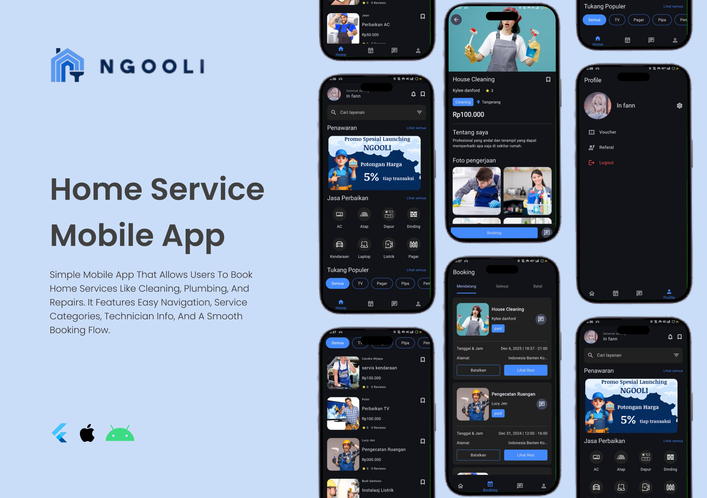

# NGOOLI – Home Service Mobile App

**NGOOLI** is a home service mobile application built with **Flutter** and **Firebase** that helps users find and book trusted home service professionals easily and efficiently.

The application provides various home services, including cleaning, plumbing, electrical installation, appliance repair, and other household maintenance services. With a simple and intuitive interface, users can explore service categories, view technician profiles, and manage their bookings in one place.

## Application Preview

NGOOLI features a modern dark-mode interface designed to provide a comfortable and seamless mobile experience.

<!-- Replace this path with your actual screenshot location in the repository -->


## Features

- **User Authentication** — Secure user authentication and account access.
- **Home Dashboard** — Browse featured promotions, service categories, and popular technicians.
- **Service Categories** — Explore services such as AC repair, roofing, kitchen maintenance, wall installation, vehicle services, laptop repair, electrical installation, and fencing.
- **Technician Profiles** — View technician information, service descriptions, pricing, ratings, and work portfolios.
- **Service Booking** — Book home services based on the selected service and preferred schedule.
- **Booking Management** — View upcoming, completed, and cancelled bookings.
- **Booking Status** — Track booking information and access available booking details.
- **Promotions and Discounts** — Discover special offers and transaction discounts.
- **Wishlist** — Save preferred service providers for easier access.
- **Voucher and Referral** — Access vouchers and referral features.
- **User Profile** — Manage profile information and account settings.
- **Real-Time Data** — Retrieve and synchronize application data using Firebase services.

## Tech Stack

| Technology | Purpose |
|---|---|
| [Flutter](https://flutter.dev/) | Cross-platform mobile application development |
| [Dart](https://dart.dev/) | Primary programming language |
| [Firebase Authentication](https://firebase.google.com/products/auth) | User authentication and account management |
| [Cloud Firestore](https://firebase.google.com/products/firestore) | Store and synchronize application data |
| [Firebase Storage](https://firebase.google.com/products/storage) | Store service images, profile photos, and portfolios |
| [Firebase Cloud Messaging](https://firebase.google.com/products/cloud-messaging) | Push notifications, if enabled |

## Getting Started

Follow these steps to run NGOOLI locally.

### Prerequisites

Make sure you have installed:

- Flutter SDK
- Dart SDK (included with Flutter)
- Android Studio or Visual Studio Code
- Android emulator, iOS simulator, or a physical device
- A Firebase project

### 1. Clone the Repository

```bash
git clone https://github.com/your-username/ngooli.git
cd ngooli
```

Replace `your-username` with your GitHub username or organization.

### 2. Install Dependencies

```bash
flutter pub get
```

### 3. Configure Firebase

Create a Firebase project in the [Firebase Console](https://console.firebase.google.com/).

Configure the Firebase services required by your application, such as Authentication, Cloud Firestore, and Storage.

The recommended setup uses FlutterFire CLI:

```bash
dart pub global activate flutterfire_cli
flutterfire configure
```

This generates or updates `lib/firebase_options.dart` and configures the selected platforms.

Ensure Firebase is initialized in `main.dart` before running the application:

```dart
import 'package:firebase_core/firebase_core.dart';
import 'package:flutter/material.dart';

import 'firebase_options.dart';

Future<void> main() async {
  WidgetsFlutterBinding.ensureInitialized();

  await Firebase.initializeApp(
    options: DefaultFirebaseOptions.currentPlatform,
  );

  runApp(const MyApp());
}
```

Replace `MyApp` with the root widget used in your project if necessary.

### 4. Run the Application

```bash
flutter run
```

To check connected devices:

```bash
flutter devices
```

### 5. Build the Application

Build an Android APK:

```bash
flutter build apk --release
```

Build an Android App Bundle:

```bash
flutter build appbundle --release
```

Build for iOS on macOS:

```bash
flutter build ios --release
```

## Firebase Integration

Firebase can serve as the backend infrastructure for NGOOLI.

| Firebase Service | Usage |
|---|---|
| Firebase Authentication | Register, sign in, and manage user identity |
| Cloud Firestore | Store users, services, technicians, bookings, reviews, and promotions |
| Firebase Storage | Store profile pictures and service portfolio images |
| Firebase Cloud Messaging | Notify users about booking updates and promotions |

### Suggested Firestore Collections

```text
users/
services/
technicians/
bookings/
categories/
promotions/
vouchers/
reviews/
```

Example booking document:

```json
{
  "userId": "user_id",
  "technicianId": "technician_id",
  "serviceId": "service_id",
  "serviceName": "House Cleaning",
  "status": "pending",
  "scheduledAt": "timestamp",
  "createdAt": "timestamp"
}
```

The collection names, fields, and booking statuses should be adapted to the actual Firebase schema implemented in the project.

## UI/UX Design

NGOOLI is designed with a focus on usability and accessibility.

- Dark-themed interface with clear visual hierarchy.
- Intuitive bottom navigation.
- Search functionality for finding services.
- Category filters for browsing technicians.
- Service cards with pricing, ratings, and provider information.
- Detailed technician profiles with portfolio images.
- Booking screens for viewing and managing reservations.
- Dedicated profile screen for account-related features.

## 🔐 Security

To protect application data:

- Use Firebase Authentication to identify users.
- Configure Firestore Security Rules to restrict access to authorized data.
- Configure Storage Security Rules to control file uploads and access.
- Validate booking data and permissions before allowing changes.
- Never commit private keys, service account credentials, or sensitive configuration files to a public repository.

## Future Improvements

- Online payment integration.
- Live technician location tracking.
- In-app chat between customers and technicians.
- Push notifications for booking confirmations and status changes.
- Advanced search and service filtering.
- Technician availability scheduling.
- Customer reviews and ratings.
- Multi-language support.

## Contributing

Contributions, suggestions, and bug reports are welcome.

1. Fork this repository.
2. Create a feature branch.
3. Commit your changes.
4. Push the branch to your fork.
5. Open a pull request.

## License

This project is currently not associated with a specified open-source license. Add a `LICENSE` file before distributing it under an open-source license.

---

**NGOOLI – Making Home Services Easier.**

Built with Flutter and Firebase.
